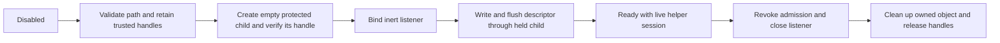

# ADR: bundled Windows scripting security helper

**Status:** Proposed implementation design; runtime enforcement unimplemented.
**Date:** 2026-10-29
**Deciders:** Maintainers and independent security/runtime reviewers. The product
choice to bundle a self-contained helper is already resolved.

## Context and constraints

The opt-in service in `desktop/script-control.cjs` currently listens before
creating its bearer descriptor with Node `wx,0600`. Its normal cleanup compares
token contents and then unlinks a pathname. These operations do not establish
Windows file privacy or retained object identity. The standalone directory
observer is metadata only and always reports `privacyEstablished:false`.
The [existing privacy reference](SCRIPT-DESCRIPTOR-PRIVACY.md) remains pending.

The boundary protects against other nonprivileged accounts. Same-user processes,
administrators and SYSTEM are outside the isolation guarantee. Ordinary drawing
startup must remain usable when optional scripting cannot start. No service,
elevation, account creation, execution-policy override, separately installed
PowerShell, or automatic repair of existing directory permissions is proposed.

## Decision

Propose a small same-privilege native Windows helper, bundled with the application,
that owns directory and child-file handles for the entire scripting lifetime.
It must perform creation, security/identity verification, publication and cleanup
as one supervised lifecycle. A report that Node later follows with pathname-based
creation is insufficient. A separate process avoids an Electron native-addon ABI
dependency, at the cost of a versioned IPC and crash-management boundary.

The initial implementation target is a native x64 executable with a reviewed OS
DLL import closure and no separate managed runtime prerequisite. Static runtime
linking is a build proposal, not proof of self-containment. Compiler/SDK versions,
binary identity, license obligations and import closure need reproducible evidence.
A bounded local inventory did not establish a working native C/C++ toolchain.
Existing managed compiler files do not establish that native build prerequisite.
Exact local inventory belongs in private run evidence.

## Options considered

| Option | Benefit | Cost or limit | Disposition |
| --- | --- | --- | --- |
| Bundled native helper process | Direct Windows handles; no Electron addon ABI | Native toolchain, IPC, packaging and lifecycle qualification | Proposed |
| Native addon | Direct in-process handles | Electron ABI/rebuild coupling and main-process failure surface | Deferred |
| Managed helper | Existing development tools may help prototype | Distribution/runtime compatibility and interop still require evidence | Not selected for the initial native target |
| External PowerShell 7 | Available on some developer machines | Separate installation and policy dependency | Superseded by the resolved product choice |
| Metadata observer or Node mode bits | Existing reference tools | Cannot establish this admission boundary | Never an admission fallback |

## Handle and security requirements

1. Before opening the descriptor, listening, or generating/writing a capability,
   reject unsupported path spellings deliberately. The initial contract accepts
   only ordinary absolute local-drive paths; reject UNC/device/extended namespaces,
   alternate streams, drive/root-relative paths, NUL, ambiguous dot/space segments
   and reserved device names. Do not normalize a forbidden spelling into acceptance.
   Fixed NTFS is the proposed first qualification target; ReFS remains unsupported
   until its identity/security cases are qualified. This is a proposed supported
   subset, not a claim that existing scripting is hardened. See
   [Windows naming rules](https://learn.microsoft.com/en-us/windows/win32/fileio/naming-a-file).
2. Establish the starting volume/root independently, then retain handles while
   resolving one component relative to the retained parent. Reject reparse objects
   and incorrect object types at each step. `NtCreateFile` documents relative
   names through `RootDirectory`; the precise user-mode option combinations and
   starting-root acquisition still require a reviewed prototype. Do not treat
   `OBJ_DONT_REPARSE` alone, a final-path string, or one final-component reparse flag
   as proof for the whole chain.
   [NtCreateFile](https://learn.microsoft.com/en-us/windows/win32/api/winternl/nf-winternl-ntcreatefile).
3. Inspect owner and DACL from each held object with `READ_CONTROL`. The initial
   private leaf/child policy should accept only a narrowly reviewed ACL grammar
   whose applicable grants go to the current token user, SYSTEM and administrators.
   Reject missing/null/empty/unreadable ACLs and unsupported ACE/group semantics.
   Rejecting an unsupported pattern does not prove that an account has access.
   Ancestors need separate replacement/mutation analysis; do not require every
   volume ancestor to be owned by the current user. A held handle does not freeze
   ACL changes. Microsoft explicitly states that `GetSecurityInfo` does not solve
   concurrent security-descriptor changes.
   [GetSecurityInfo](https://learn.microsoft.com/en-us/windows/win32/api/aclapi/nf-aclapi-getsecurityinfo).
4. Create the child exclusively, relative to the retained parent, with an explicit
   reviewed protected creation DACL. Verify the returned creation result and that
   exact child's type, reparse state, owner, DACL and identity before any secret
   bytes. Do not rely on inherited defaults. Compare supported volume/file IDs
   while handles remain held; do not use a pathname or reusable historical ID as
   lifetime identity. Unsupported link/identity evidence fails closed.
   [New-object DACL rules](https://learn.microsoft.com/en-us/windows/win32/secauthz/dacl-for-a-new-object),
   [file identity limitations](https://learn.microsoft.com/en-us/windows/desktop/api/fileapi/ns-fileapi-by_handle_file_information).
5. Retain directory and child handles with reviewed sharing restrictions while
   scripting is active. Omitting delete sharing can prevent conflicting future
   delete/rename opens; it is not an ACL lock or a general race proof. Cleanup must
   target the held created object, using a qualified handle-based disposition
   operation. Never delete a replacement based on matching token contents or by
   reopening a pathname. Revoke admission and close the service before cleanup;
   failure leaves a fixed redacted residual-artifact diagnostic, not a deletion
   success claim. Crash cleanup is a separate test obligation.
   [CreateFileW sharing](https://learn.microsoft.com/en-us/windows/win32/api/fileapi/nf-fileapi-createfilew),
   [SetFileInformationByHandle](https://learn.microsoft.com/en-us/windows/win32/api/fileapi/nf-fileapi-setfileinformationbyhandle).

## IPC and live admission

Launch only the manifest-bound helper at its resolved application resource path,
without a shell or visible console. Use dedicated inherited IPC handles; do not
put credentials in arguments, environment variables, diagnostics, or public
receipts. Protocol version, bounded frame sizes, fixed operations, sequence numbers,
per-launch session identity, timeouts and EOF handling must be explicit contracts.
There is no operation for arbitrary commands, scripts, ACL editing or file reads.
Helper stdout/stderr must not echo requests, paths, account identifiers or secrets.

Proposed lifecycle, still requiring implementation:

Any error transitions to revocation/owned cleanup, with no insecure fallback.
Preflight rejection means zero descriptor opens, listener calls or credential
writes; directory metadata-handle opens are distinct from descriptor creation.
After successful preflight, child-creation failure must still precede listening.
Descriptor write/sync failure may occur after an inert listener exists, but must
never leave it admitted. A successful metadata report alone cannot enter Ready.

Each request needs the current session/readiness state and a fresh, bounded helper
round trip before dispatch. Helper death, EOF, timeout, protocol/session mismatch
or failed identity/security evidence revokes readiness and rejects further
dispatch. An already accepted drawing transaction must follow the existing engine
transaction contract; do not invent automatic Undo. This is a proposed gating
rule, not a claim of instantaneous crash detection or elimination of every race.
Parent/helper termination, stale responses and concurrent close require tests.

## Separate client and server identity gate

Protecting the descriptor does not authenticate the peer reached by its endpoint.
`tools/linecraft-control.cjs` currently has no separate server-identity proof before
transmitting credentials and request data. That observation is code inspection,
not a demonstrated exploit. Detailed local findings remain in private evidence.

Before security-qualified integration, review authenticated transport and descriptor
versioning for both producer and client. Pinned TLS and explicitly secured local
pipes are candidates. A plaintext nonce/HMAC exchange alone is not a complete
answer to active relay or payload disclosure. Do not silently downgrade to the
existing HTTP protocol or treat a loopback address, port, PID or live-helper lease
as peer authentication. No transport has been selected or qualified here.

## Qualification and consequences

| Later evidence | Required result |
| --- | --- |
| Pure fake-IPC/service contracts | Specific rejection and zero prohibited effects; normal disabled startup preserved |
| Real synthetic Windows objects | Final-child ACL/identity, inheritance, hardlink/reparse/ancestor replacement and cleanup behavior |
| Helper failure injection | EOF/death/timeout/mismatch revokes readiness; no secret in errors; replacement objects preserved |
| Independent nonprivileged account | Descriptor read and protected-subtree mutation denied under the declared boundary |
| Client transport negatives | Unproven/stale/wrong-session peers receive no credential or private request payload |
| Exact source and unpacked candidate | Same helper identity, protocol, behavior and failure handling |

Existing red namespace references and observer evidence are preserved; unchanged
passing gates must not be called security qualification. Missing native tools,
unresolved traversal/API semantics and client transport identity remain prerequisites.
Do not create accounts, install toolchains, change existing ACLs or enable an
endpoint merely to complete this design record.

Implementation adds a binary and packaging identity beyond the present59 runtime
files/12 resources. That requires a deliberately reviewed future manifest/closure,
package mapping, reproducible build and dependency/import checks. This record
changes no runtime, package version, manifest, installer or installed state.

## Ordered action items

1. Define bounded fake-IPC/service lifecycle contracts and independent failure
   expectations, keeping Windows privacy explicitly unproven.
2. Establish a permitted reproducible native toolchain and prototype retained
   traversal/creation/cleanup on owned synthetic objects only.
3. Resolve and review client transport identity/versioning before enabling an
   integrated security claim; preserve ordinary-startup behavior.
4. Implement one coherent runtime change with failing references, independent
   review and a new exact cumulative candidate identity.
5. Perform real Windows, cross-account, source/unpacked and later coordinated
   native/installed qualification separately. No publication is authorized here.
